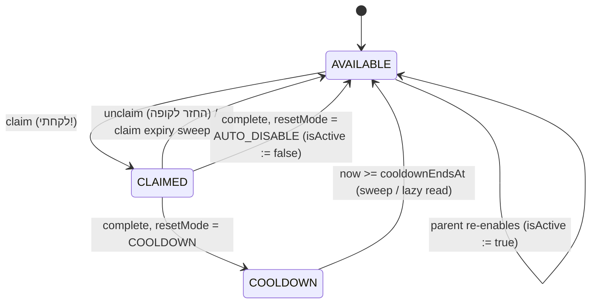

# habait — Architecture

Local-first Hebrew RTL family task app. One Node process (Fastify) serves the SPA and `/api/v1/*` on port 3000; SQLite (WAL) is the only store. Everything runs in `TZ=Asia/Jerusalem`.

## 1. Layer boundaries

```
HTTP (Fastify routes) ──► Domain Services ──► DB Repositories (Drizzle) ──► SQLite
        ▲                       │
        └── Zod contracts ◄─────┘   (packages/shared)
```

| Layer | Lives in | May | Must not |
| :-- | :-- | :-- | :-- |
| **Routes** | `server/src/routes` | Parse/validate with `@habait/shared` Zod schemas, read the session, call **one** service method, map `DomainError` → `ERROR_HTTP_STATUS`, serialize the response schema. | Query the DB, hold state rules, compute dates. |
| **Domain services** | `server/src/services` | Own every state transition and invariant. Take `now` / `Db` as parameters (pure + deterministic in tests). Throw typed domain errors (`DomainValidationError`, error codes from `ERROR_CODES`). Wrap multi-row changes in a single `db.transaction`. | Know about HTTP, cookies, Fastify. |
| **Repositories** | `server/src/db` (+ `repositories/`) | Typed Drizzle queries, row ↔ DTO mapping. | Decide business rules. |
| **Shared** | `packages/shared` | Enums, Zod schemas / DTO types, error codes, Hebrew copy, timezone helper signatures. No I/O. | Import from server or web. |
| **Web** | `packages/web` | Render DTOs, call `/api/v1` with relative URLs. | Duplicate domain rules; it only reflects server-reported state. |

The schema also enforces a last line of defence (see `server/src/db/schema.ts`): PARENT must have a PIN hash, stars ≥ 0, no self peer-requests, one routine log per `(routineId, logicalDate)`, pool state ↔ claim/cooldown column consistency, and **at most one `CLAIMED` pool task per user** (partial unique index). Services still check first so clients get the proper error code (`POOL_WIP_LIMIT_REACHED`, 409) instead of a raw constraint failure.

Conventions: timestamps are Unix ms; calendar dates are `YYYY-MM-DD` strings in Asia/Jerusalem (`LogicalDate`); stars are only ever `SUM(star_transactions.starsDelta)`; history rows carry title snapshots and are never cascade-deleted (users/templates are soft-deleted with `isActive`).

## 2. `pool_tasks` state machine (`קופת המשימות`)

States: `AVAILABLE`, `CLAIMED`, `COOLDOWN`. A task with `isActive = false` is hidden and cannot be claimed regardless of state.



Exact transitions (`now` = injected clock):

| Event | Guard (else error) | Effect |
| :-- | :-- | :-- |
| **claim** by user *U* | `isActive` and `state = AVAILABLE` (`POOL_TASK_NOT_AVAILABLE`); *U* has no other `CLAIMED` task (`POOL_WIP_LIMIT_REACHED`) | `state = CLAIMED`, `claimedByUserId = U`, `claimedAt = now`, `claimExpiresAt = now + 3_600_000` |
| **unclaim** by claimer or any parent | `state = CLAIMED`; actor is claimer or PARENT (`POOL_NOT_CLAIMER`) | `state = AVAILABLE`; `claimedByUserId`, `claimedAt`, `claimExpiresAt` = `null` |
| **expiry** (sweep every 60 s + lazy on read) | `state = CLAIMED` and `now >= claimExpiresAt` | same as unclaim |
| **complete** by *U* | `state = CLAIMED`, `claimedByUserId = U` (`POOL_NOT_CLAIMER`), `now < claimExpiresAt` (`POOL_CLAIM_EXPIRED`) | Insert `pool_task_executions` row (snapshots, `starsAwarded = stars`, `logicalDate`); if `stars > 0` insert `star_transactions` (`POOL`, `+stars`); `lastCompletedAt = now`; clear claim columns; then per `resetMode` ↓ |
| …`COOLDOWN` mode | | `state = COOLDOWN`, `cooldownEndsAt = now + cooldownMinutes * 60_000` |
| …`AUTO_DISABLE` mode | | `isActive = false`, `state = AVAILABLE`, `cooldownEndsAt = null` |
| **cooldown end** (sweep + lazy on read) | `state = COOLDOWN` and `now >= cooldownEndsAt` | `state = AVAILABLE`, `cooldownEndsAt = null` |
| **revert execution** (executor same day, or any parent) | `revertedAt IS NULL` (`REVERT_NOT_ALLOWED`) | `revertedAt = now`; if `stars > 0` insert `star_transactions` (`REVERT`, `-stars`); if `resetMode = AUTO_DISABLE`: `isActive = true`, `state = AVAILABLE` |
| **parent toggle** | — | flips `isActive` only (allowed at any time per spec; claim/cooldown columns are untouched) |

All transitions run in one DB transaction. Sweeps and lazy reads call the same pure `expire(task, now)` function so they cannot diverge.

## 3. Midnight rollover (`00:00` Asia/Jerusalem)

`runDailyRollover(targetDate)` — closes out `targetDate` (the day that just ended). Idempotent.

1. Compute `dow = getIsraeliDayOfWeek(targetDate)` (0 = Sunday … 6 = Saturday).
2. Select active `routine_templates` whose `daysOfWeekJson` contains `dow`, **and** for which no row exists in `routine_daily_logs` for `(routineId, targetDate)`. (A `COMPLETED` row, or a previously written `MISSED` row, both mean "already settled".)
3. `INSERT … ON CONFLICT (routineId, logicalDate) DO NOTHING` a `MISSED` row for each, copying `titleSnapshot`, `iconEmojiSnapshot`, `timeWindowSnapshot` from the template, `completedAt = NULL`. The unique index makes concurrent/repeated runs safe.
4. Leave `one_off_tasks (PENDING)` and `peer_requests (PENDING)` untouched — they roll over by definition.
5. The new day starts clean with no extra work: "today's open routines" = scheduled for today's `dow` with no log row for today.

Triggers:
- **Cron** `0 0 * * *` with `timezone: "Asia/Jerusalem"` → `runDailyRollover(yesterday)`.
- **Boot catch-up**: find the last settled date (`MAX(logicalDate)` over `routine_daily_logs`, or the earliest `createdAt` date of an active template if none) and run `runDailyRollover(d)` for every date `d` from there up to *yesterday*, oldest first, so a powered-off LXC never loses a day. A template only counts for dates on/after its own `createdAt` date.
- The same sweep tick (every 60 s) performs pool claim expiry and cooldown completion.

Gotchas: iterate by calendar date strings (not by adding 24 h) to stay correct across the DST shifts of Asia/Jerusalem; never use host-local time.

## 4. Spec gaps decided in Milestone 1

- `getCurrentTimeWindow` resolves `00:00–04:59` (uncovered by the spec) to `EVENING`.
- Rollover also respects a template's `createdAt`: no retroactive `MISSED` rows for days before it existed.
- `UpdateUserRequest.pin = null` is schema-valid; the user service rejects it for PARENT (needs the stored role).
- Timezone helpers exist as signatures that throw in `packages/shared/src/time.ts`; bodies come test-first in Milestone 2.
